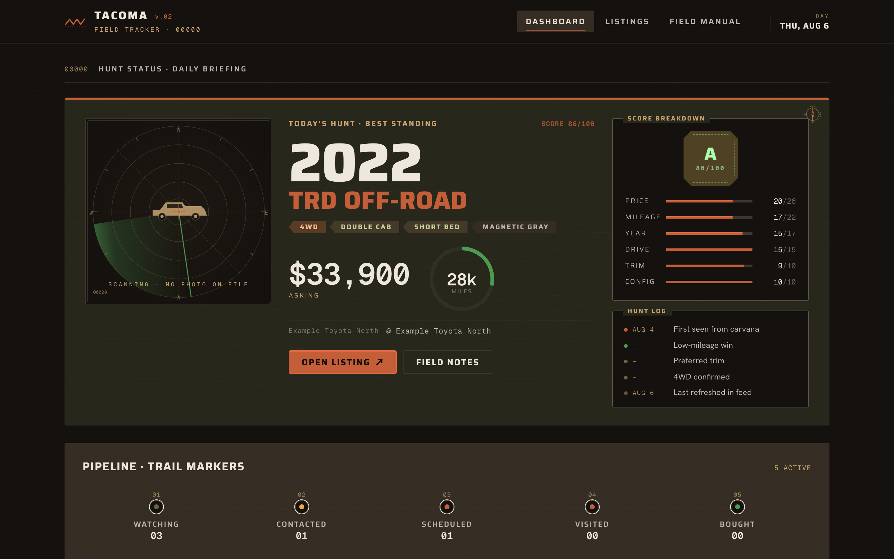
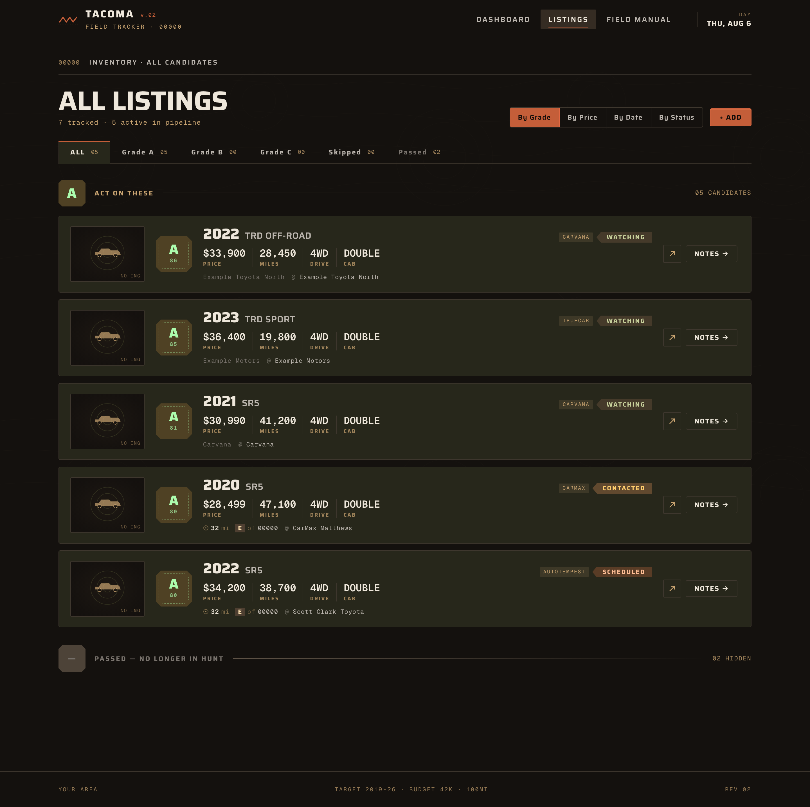
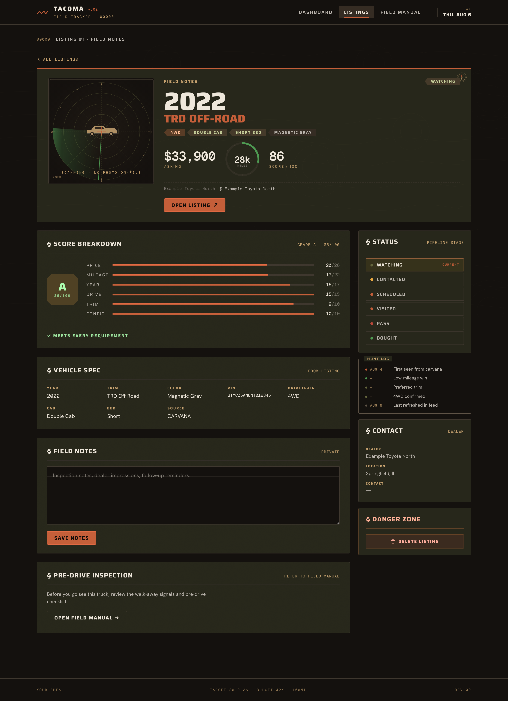
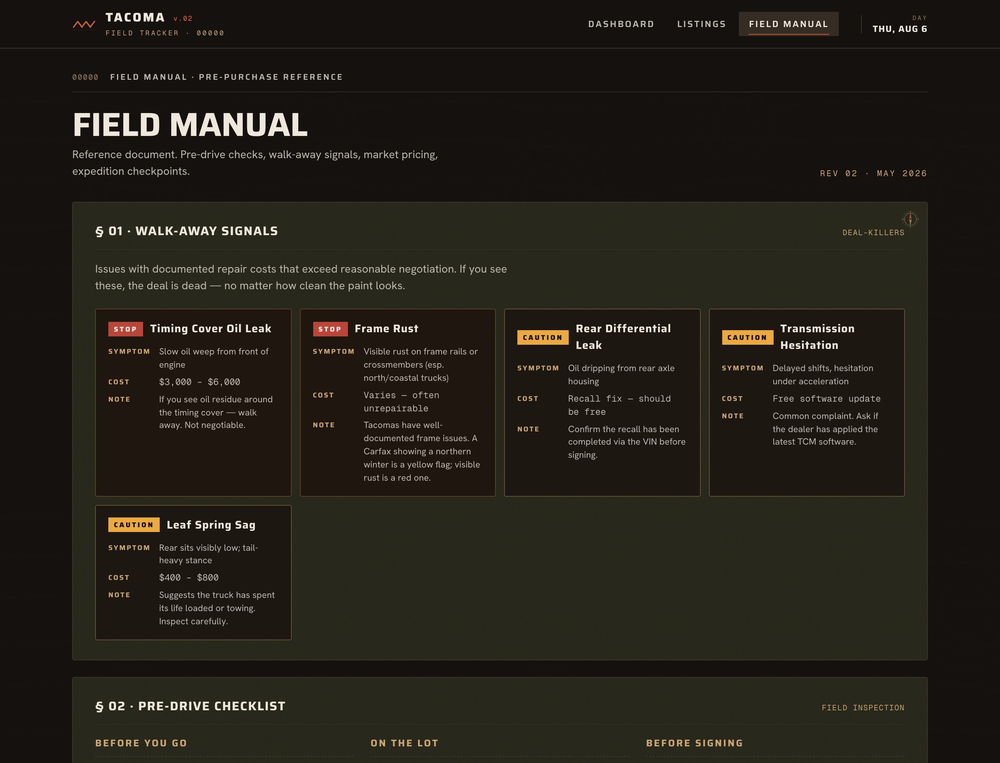
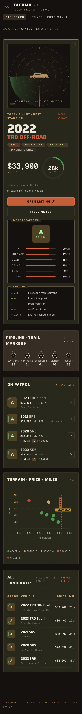

<div align="center">

# Vehicle Hunt

**A self-hosted used-vehicle tracker.** It watches the market for one specific
vehicle, scores everything it finds out of 100, and emails you a ranked
briefing every morning.

[](https://github.com/realjbmangum/vehicle-hunt/actions/workflows/ci.yml)
[](LICENSE)
[](email-worker/tests)
[](https://workers.cloudflare.com/)
[](https://astro.build/)

</div>



It was built to buy a used Toyota Tacoma. It ran for six months, tracked 1,058
trucks, and found the one that got bought. Then it was switched off — and this
is what came out of it, generalised so you can point it at whatever you're
shopping for.

> **1,058 tracked → 1,002 passed → 19 dealer conversations → 5 test drives → 1 bought.**

## Contents

- [What it does](#what-it-does)
- [Screenshots](#screenshots)
- [Features](#features)
- [Configure it](#configure-it)
- [Stack](#stack)
- [Setup](#setup)
- [Endpoints](#endpoints)
- [Tests](#tests)
- [What it can't do](#what-it-cant-do)
- [Contributing](#contributing)
- [Licence](#licence)

## What it does

**Two intakes, one pipeline.**

1. **Inventory API sweep** *(primary)* — a daily pull from a vehicle listings
   API that returns a VIN on every row. The VIN is decoded free against
   [NHTSA vPIC](https://vpic.nhtsa.dot.gov/api/), which knows the drivetrain,
   cab and bed with certainty.
2. **Saved-search emails** *(secondary)* — point your alerts from cars.com,
   AutoTempest, CarGurus, CarMax, Carvana or anywhere else at a dedicated
   address. Each one gets parsed by Claude Haiku into structured listings.

Everything then flows through the same path: hard filters → VIN decode →
cross-source deduplication → scoring → database → morning digest.

**Learn from my mistake before you start.** I built the email pipeline first
and ran it for months before measuring it. Marketing emails carried a VIN 25%
of the time and a drivetrain 30% of the time — they're written to sell a
vehicle, not describe one, and the facts you need to decide are exactly the
ones that don't help sell. The API sweep produced more usable listings in
twelve days than any email source managed in three months. **Start with the
API. Treat email as the net that catches what the API misses.**

## Screenshots

All four are the app running against the bundled `seed.sql` fake data — this is
what you see after `npm run dev`, before you've pointed it at anything real.

<table>
<tr>
<td width="50%"><a href="docs/screenshots/listings.png"></a><br><strong>The board.</strong> Grouped by grade, not price — "good deal" and "cheap" are different questions.</td>
<td width="50%"><a href="docs/screenshots/listing-detail.png"></a><br><strong>One listing.</strong> Full score breakdown, price history, and every time it moved.</td>
</tr>
<tr>
<td width="50%"><a href="docs/screenshots/field-manual.png"></a><br><strong>Field manual.</strong> Known issues, inspection checklist, market bands. The least clever page and the most used.</td>
<td width="50%" align="center"><a href="docs/screenshots/dashboard-mobile.png"></a><br><strong>Mobile.</strong> Because you open it standing on a dealer's lot.</td>
</tr>
</table>

## Features

- **Deal scoring, 0–100, A–F** — weighted across price, mileage, year,
  drivetrain, trim and configuration, with an accident deduction on top
- **VIN truth** — the VIN outranks the listing text on drivetrain, cab and bed,
  because dealers guess and VINs don't
- **Price history** — every price change on every listing, so you can see which
  seller is getting desperate
- **Cross-source twin matching** — the same vehicle listed on three sites
  collapses to one row
- **Photo capture into R2** — listing photos are copied on first sight, so a
  delisted vehicle doesn't become a grey box
- **Hard filters** — colours and drivetrains you refuse are dropped at ingest
  and never shown to you
- **Bait-price detection** — a suspiciously low price is flagged rather than
  promoted to the top of your watchlist, which is what mine did before I fixed it
- **`/replay`** — dry-run parser changes over emails you've already received,
  writing nothing. Measure a change before it touches your data.

## Configure it

Everything lives in [`hunt.config.ts`](hunt.config.ts). One file. It sets the
vehicle, the criteria, your location, the colours you refuse, and the scoring
ladder — and it feeds the LLM prompt, the filters, the API sweep, the scoring
math and the dashboard chrome.

```ts
export const HUNT: HuntConfig = {
  vehicle: {
    label: "Toyota Tacoma",
    make: "Toyota",
    model: "Tacoma",
    modelAliases: ["tacoma"],
    // ...
  },
  criteria: {
    yearMin: 2019,
    yearMax: 2026,
    maxMileage: 75000,
    maxPrice: 42000,
    requiredDrivetrain: "4WD",
    // ...
  },
  location: { zip: "00000", radiusMiles: 100, /* ... */ },
  // ...
};
```

Nothing else in the codebase hardcodes a vehicle, a price or a location. If you
find something that does, that's a bug — please open an issue.

## Stack

Astro dashboard on Cloudflare Pages · ingest worker on Cloudflare Workers ·
D1 for storage · R2 for photos · Claude Haiku for email parsing ·
NHTSA vPIC for VIN decoding.

Runs comfortably inside free tiers. The only meaningful cost is Claude API
usage on inbound email, which ran to a couple of dollars a month.

## Setup

**Prerequisites:** a Cloudflare account, an [Anthropic API
key](https://console.anthropic.com/), and a domain on Cloudflare if you want
the email intake.

```bash
git clone https://github.com/realjbmangum/vehicle-hunt.git
cd vehicle-hunt
npm install
```

**1. Edit `hunt.config.ts`** — the vehicle, criteria and location are yours.

**2. Create the database and bucket.**

```bash
npx wrangler d1 create vehicle-hunt-db
npx wrangler r2 bucket create vehicle-hunt-photos
```

**3. Wire up config.** Copy both examples and paste in the `database_id`
printed above:

```bash
cp wrangler.example.jsonc wrangler.jsonc
cp email-worker/wrangler.example.jsonc email-worker/wrangler.jsonc
```

Both are gitignored, so your IDs and addresses stay out of git.

**4. Create the schema.**

```bash
npx wrangler d1 execute vehicle-hunt-db --remote --file=./src/data/schema.sql
cd email-worker
for m in migrations/*.sql; do npx wrangler d1 execute vehicle-hunt-db --remote --file="$m"; done
```

**5. Set secrets.**

```bash
cd email-worker
npx wrangler secret put ANTHROPIC_API_KEY   # required
npx wrangler secret put TRIGGER_TOKEN       # required — any long random string
npx wrangler secret put AUTODEV_API_KEY     # optional — enables the API sweep
```

**6. Deploy.**

```bash
cd email-worker && npx wrangler deploy
cd .. && npm run build && npx wrangler pages deploy dist
```

**7. Point mail at it** *(optional)*. In the Cloudflare dashboard, under Email
Routing, create an address and route it to the worker. Then set your
saved-search alerts on the listing sites to that address.

Update `notify.photoBaseUrl` in `hunt.config.ts` with the worker URL that
`wrangler deploy` printed, so stored photos resolve.

## Endpoints

All guarded by `TRIGGER_TOKEN`.

| Route | What it does |
| --- | --- |
| `/sweep?token=…&dry=1` | Run the inventory pull. `dry=1` reports what it *would* write, without writing. |
| `/digest?token=…` | Build and send the digest now. |
| `/replay?token=…&since=2026-07-01&limit=25` | Re-parse stored emails with the current parser. Writes nothing. |
| `/img/<key>` | Serves captured photos out of R2. |

## Tests

```bash
cd email-worker && npm test
```

83 tests, no network, no mocks of our own code — VIN decoding, scoring, twin
matching and the inventory mapper are all covered against real captured
payloads.

## What it can't do

**Private-party listings.** Inventory APIs index dealer stock. Facebook
Marketplace and Craigslist are invisible to it, and that's often where the
sharper prices are. Email alerts don't reach them either. No API solves this —
that gap stays manual.

**Tell you a price is honest.** A dealer posted a fictional $16,094 truck and my
scorer put it top of the board at Grade A. There's bait detection now, but a
scoring function is a statement about what you value, and anything that games
the inputs games you.

## Contributing

Contributions welcome — see [CONTRIBUTING.md](CONTRIBUTING.md) for setup and
the one architectural rule (nothing outside `hunt.config.ts` hardcodes a
vehicle, price or location).

**The most useful thing you could add** is a worked `hunt.config.ts` for a
different vehicle. There's an
[issue template](https://github.com/realjbmangum/vehicle-hunt/issues/new?template=vehicle_profile.yml)
for exactly that.

Also: [Code of Conduct](CODE_OF_CONDUCT.md) ·
[Security policy](SECURITY.md) · [Changelog](CHANGELOG.md)

## Licence

MIT — see [LICENSE](LICENSE). Use it, fork it, sell it. If you buy something
good with it, that's the whole point.

---

<div align="center">
<sub>Built to buy one truck. It worked, so it was switched off.</sub>
</div>
